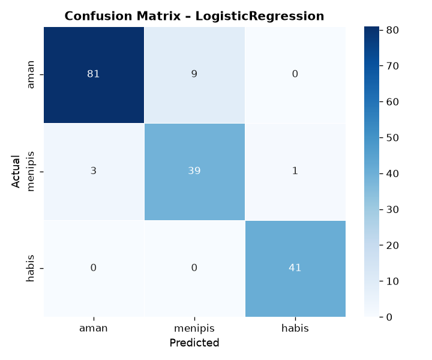
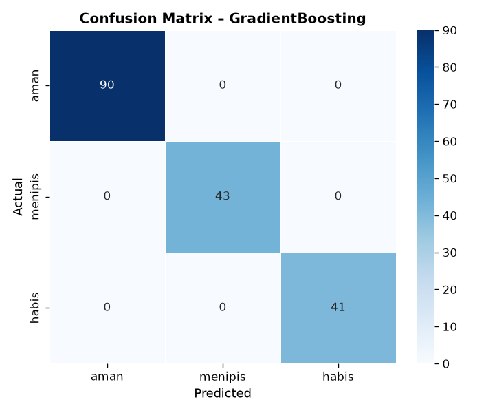
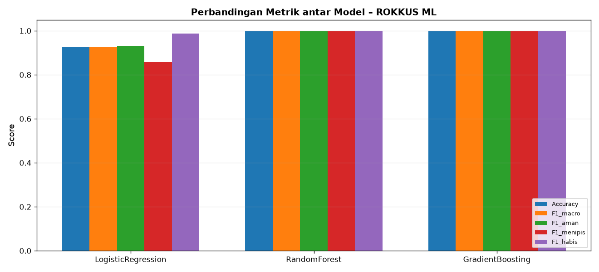

# Laporan Perbandingan Model – ROKKUS ML

> **Tanggal evaluasi**: 2026-11-22 20:09
> **Data**: sample_data/stok_harian.csv
> **Split**: train (awal 80%) / test (akhir 20%) berbasis waktu

## Tabel Perbandingan

| Model              |   Accuracy |   Precision_macro |   Recall_macro |   F1_macro |   F1_aman |   F1_menipis |   F1_habis |
|:-------------------|-----------:|------------------:|---------------:|-----------:|----------:|-------------:|-----------:|
| LogisticRegression |     0.9253 |            0.9177 |         0.9357 |     0.9254 |     0.931 |       0.8571 |      0.988 |
| RandomForest       |     1      |            1      |         1      |     1      |     1     |       1      |      1     |
| GradientBoosting   |     1      |            1      |         1      |     1      |     1     |       1      |      1     |

## Confusion Matrix

### LogisticRegression

### RandomForest

### GradientBoosting

## Perbandingan Metrik (Bar Chart)

## Alasan Pemilihan Model Terbaik

Model terpilih adalah **RandomForest** dengan F1 Macro = **1.0000** dan Accuracy = **1.0000** pada test set.

F1 Macro dipilih sebagai kriteria utama karena distribusi kelas (_aman_, _menipis_, _habis_) tidak seimbang, dan kelas minoritas (_habis_, _menipis_) lebih krusial secara bisnis. F1 Macro memberikan bobot setara pada tiap kelas terlepas dari frekuensinya.

## Keterbatasan dan Catatan

### Label dari Aturan Eksplisit (Rule-Based Labeling)
Label `status_stok` dibuat dari aturan deterministic berbasis `stok_akhir` dan `batas_minimum` yang didefinisikan di `configs/config.yaml`. Ini berarti model _mempelajari ulang_ aturan tersebut dari fitur-fitur turunannya (misalnya `days_of_cover`, `rasio_stok`). Dalam konteks produksi, label asli dari tim operasional ROKKUS akan membuat evaluasi lebih jujur.

### Potensi Kebocoran Data (Data Leakage)
Fitur `stok_saat_ini` (alias `stok_akhir`) dan `batas_minimum` berkaitan langsung dengan label. Meskipun tidak dimasukkan _verbatim_ sebagai fitur label, turunannya (`days_of_cover`, `rasio_stok`) sangat kuat secara prediktif. Hal ini wajar karena memang fitur-fitur itu yang relevan secara bisnis, namun harus dipahami bahwa _high accuracy_ sebagian disebabkan oleh sifat rule-based labeling, bukan karena model menangkap pola yang kompleks.

### Data Sintetis
Seluruh data dihasilkan oleh `src/make_dummy_data.py` dan bukan data asli ROKKUS. Distribusi stok, pola musiman, dan variabilitas di data nyata mungkin berbeda secara signifikan. Lakukan retraining dengan data asli sebelum deployment.

### Split Berbasis Waktu
Evaluasi menggunakan split waktu (train = awal, test = akhir) untuk menghindari kebocoran temporal. Ini lebih konservatif dari random split dan lebih merepresentasikan performa saat deploy ke produksi.
